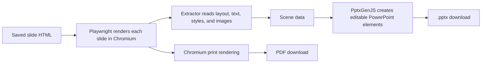

# Loomvra

Loomvra turns a presentation brief into editable slides. It creates a design plan, finds images, renders slides as HTML, and lets you revise the result in the browser before exporting it as PDF or PowerPoint.

## Product demo

https://github.com/user-attachments/assets/adcd206a-02e0-45ea-82cd-5973b5f93768

## What it does

- Creates a design plan from a project brief, with optional brand colors, fonts, guidance, and logo.
- Generates slide HTML from the plan and previews it in the app.
- Lets you update slides with the editor, revise the design, and search Pexels for images.
- Exports the slides as PDF or an editable PPTX file.

The design plan and slide generation use OpenRouter, so you can choose compatible models in Settings. Pexels supplies image search results. The app stores both API keys in its local SQLite settings database. Pexels offers its API without a fee under its API rules and default rate limits. OpenRouter model requests may incur provider charges depending on the model and account.

## Run locally

Install Node.js 20.19 or newer and npm. Install and start Redis on `127.0.0.1:6379`, then follow the full setup guide in [docs/setup-and-architecture.md](docs/setup-and-architecture.md).

```sh
npm install
npx playwright install chromium
npm run dev
```

Open the Vite URL printed in the terminal, normally `http://localhost:5173`. Add an OpenRouter API key, a model for design and slide generation, and a Pexels API key in Settings.

## How PPTX export works

The saved slides are HTML. Export does not put web pages inside a PowerPoint file. Playwright opens each slide in headless Chromium, the server reads element positions and computed styles from the rendered page, then PptxGenJS builds PowerPoint text, shapes, and images from that data.



See the [setup and architecture guide](docs/setup-and-architecture.md) for dependencies, credentials, monorepo layout, and implementation details.
