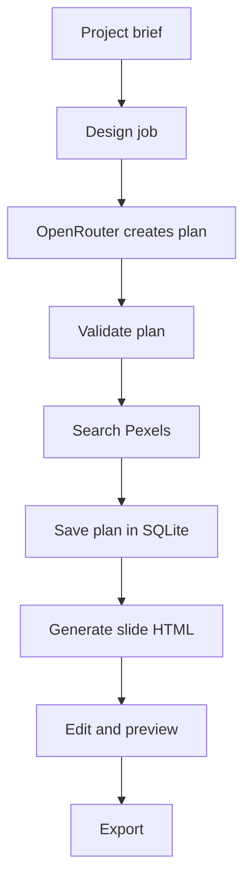

# Setup and architecture

Loomvra is an npm workspaces project with a React app, an Express server, and shared schemas. Run the commands below from the repository root.

## Requirements

- Node.js 20.19 or newer and npm.
- Redis at `127.0.0.1:6379` for background generation jobs.
- OpenRouter and Pexels API keys. Add them in the app's Settings page after startup.

The server creates `server/app.db` on first start. It stores API keys, model choices, projects, and slides in SQLite. The server also stores uploaded and downloaded images in `server/Images/`.

## Install and run

Start Redis, then install dependencies and Playwright Chromium:

```sh
npm install
npx playwright install chromium
npm run dev
```

The app runs at `http://localhost:5173`. The API and editor WebSocket use `http://localhost:3000`. Open Settings and add both API keys, then select the design and slide-generation models.

On Linux, install Chromium's system dependencies if the browser does not start:

```sh
npx playwright install-deps chromium
```

Build the frontend with:

```sh
npm run build --workspace app
```

To run one workspace, use `npm run dev --workspace app` or `npm start --workspace server`.

## Project layout

| Directory | Contents |
| --- | --- |
| `app/` | React frontend and editor. |
| `server/` | Express API, WebSocket editor, background jobs, SQLite storage, and exports. |
| `shared/` | Planning types and validation schemas. |
| `docs/` | Project documentation. |

The root `package.json` defines the npm workspaces. Run `npm install` at the root to install dependencies for all workspaces.

## Generation and export

The design job sends the project brief and optional brand details to the selected OpenRouter model. It validates the returned plan, searches Pexels for planned images, and saves the plan in SQLite. The slide job generates HTML for each slide. The editor sends revisions through the server's WebSocket route. Image search also goes through the server, which reads the Pexels key from SQLite.



PDF export renders the saved slides in Playwright Chromium and prints them as pages. PPTX export renders each slide, extracts supported text, images, and shapes, then writes those elements with PptxGenJS. Some HTML effects may not have an editable PowerPoint equivalent.

## Server environment variables

- `PORT` sets the server port. It defaults to `3000`.
- `PUBLIC_BASE_URL` sets the base URL used for image links. It defaults to `http://localhost:3000`.
- `OPENROUTER_TIMEOUT_MS` sets the OpenRouter request timeout in milliseconds. It defaults to `900000`.
