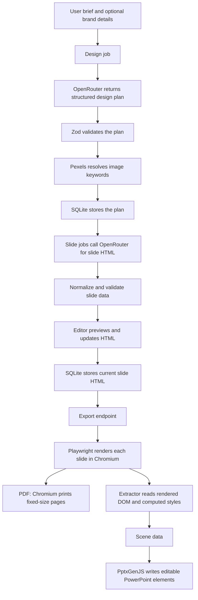
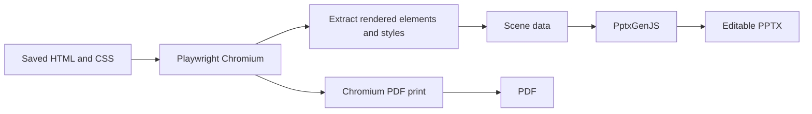

# Setup and architecture

This guide documents the current source tree. The repository is an npm workspaces monorepo with a React app, an Express server, and shared schemas. Run commands from the repository root unless a command says otherwise.

## Requirements

- Node.js 20.19 or newer and npm. Vite 8 requires a recent Node release. Use a current Node LTS release that meets this minimum.
- Redis listening at `127.0.0.1:6379`. BullMQ uses Redis for the design and slide generation queues. The Redis host and port are currently hard-coded in `server/src/config/redis.js`.
- A system-supported Chromium runtime. Playwright downloads the matching Chromium build in the install step below. Linux systems may also need browser OS libraries.
- An OpenRouter API key and a Pexels API key. Enter both in the app's Settings page after startup.

SQLite needs no separate service. The server creates `server/app.db` and the required tables on first startup. Generated and downloaded images are stored under `server/Images/`.

## Install and start

Start Redis first. On a system with a Redis service manager, enable and start its Redis service. For local development, make sure `redis-server` is running and accepts connections at `127.0.0.1:6379`.

Then install JavaScript dependencies, download Playwright Chromium, and start both app and server from the repository root:

```sh
npm install
npx playwright install chromium
npm run dev
```

If Chromium fails to launch on Linux because system libraries are missing, install the OS dependencies for Chromium with `npx playwright install-deps chromium`. Playwright documents browser and OS dependency installation in its [browser setup guide](https://playwright.dev/docs/browsers).

The frontend normally runs at `http://localhost:5173`; the API and WebSocket server use port `3000`. The server's CORS configuration currently accepts the Vite development origin `http://localhost:5173`.

For a production frontend bundle, run:

```sh
npm run build --workspace app
```

The root `npm run dev` script starts Vite and the server together. To run either workspace alone, use `npm run dev --workspace app` for the frontend or `npm start --workspace server` for the backend.

## Monorepo layout

| Path | Purpose |
| --- | --- |
| `app/` | React 19 frontend, Vite 8 development server and build, and the editor UI. |
| `server/` | Express API, WebSocket editor, background workers, SQLite storage, generation pipeline, and PDF/PPTX exports. |
| `shared/` | Shared planning data types and Zod validation. |
| `artifacts/` | README hero image and product demo video. |
| `docs/` | This setup and architecture guide. |

The root `package.json` declares `app`, `server`, and `shared` as npm workspaces. The root `package-lock.json` pins the dependency tree. Run `npm install` at the root so npm installs the whole workspace consistently.

## Applications and libraries

| Component | How this project uses it | Setup |
| --- | --- | --- |
| React, React DOM, React Router | Frontend screens, stateful editor, and navigation. | Installed by root `npm install` through `app/package.json`. |
| Vite | Frontend development server and production bundler. | Installed with the app workspace. Run `npm run dev --workspace app` or `npm run build --workspace app`. |
| Express and `ws` | HTTP API and the slide editor's WebSocket connection. | Installed with the server workspace. The server starts with `npm start --workspace server`. |
| BullMQ and ioredis | Queue design-plan and slide-generation jobs. Redis is the queue backend. | Install Redis separately and run it at `127.0.0.1:6379`. |
| Playwright and Chromium | Render and capture slides in a headless browser. The exporter uses Chromium for PDF printing and for measuring rendered HTML before PPTX conversion. | Run `npx playwright install chromium` after npm install. |
| PptxGenJS | Build `.pptx` files from extracted text, image, and shape data. | Installed with the server workspace. |
| better-sqlite3 | Store settings, projects, slide HTML, and editor chat records in `server/app.db`. | Installed with the server workspace. It is a native Node module, so use a supported Node platform and toolchain. |
| Cheerio | Parse and transform generated slide markup in the slide pipeline. | Installed with the server workspace. |
| Zod | Validate shared design plans and slide data. | Installed in the shared and server workspaces. |
| OpenRouter | Send model requests for design planning, slide HTML, and editor assistance. The configured model IDs come from Settings. | Create an OpenRouter key and enter it in Settings. See [OpenRouter's API key documentation](https://openrouter.ai/docs/api/api-reference/api-keys/create-keys). Model usage pricing depends on the chosen model and provider. |
| Pexels API | Search for candidate photos during design planning and in the editor image search. | Create a Pexels API key and enter it in Settings. Pexels states that the API is free under its terms, with default limits of 200 requests per hour and 20,000 requests per month. See [Pexels API documentation](https://www.pexels.com/api/documentation/). |

The app source also supports `VITE_PEXELS_API_KEY` for its client-side image picker. The project currently has an ignored `app/.env` file for local development. Do not commit API keys. The server `.env` file was removed because no code loads it. The backend reads API keys from the SQLite settings row instead.

## Configure API keys and models

Start the app and server, open Settings, and enter:

- OpenRouter API key.
- Pexels API key.
- A design model and a slide-generation model. The settings page verifies keys and offers model selection.

The API persists settings, including API keys and selected model IDs, in the singleton settings row in SQLite. The design job sends the project brief and optional brand details to the configured design model. It validates the returned plan, then looks up each planned image keyword in Pexels and stores the resulting image URL in the plan.

The slide job makes a model request for each slide and stores the resulting HTML. The editor can send follow-up requests through the WebSocket route, and the model can call the Pexels image-search tool when a user asks for images. The editor's changes are applied to the generated slide content and can be exported after review.

Pexels API access is free under Pexels' current API terms and limits. Follow Pexels attribution and use requirements. OpenRouter is a routing API; request costs depend on the selected model and its provider. Check the model's current pricing in OpenRouter before using it.

## Generation and export flow



### PDF export

The server retrieves each slide's saved HTML, applies the current slide validation and rendering steps, and embeds remote image assets as data URLs. Playwright opens a headless Chromium page with a 16:9 viewport. Chromium prints one fixed-size PDF page per slide with backgrounds enabled.

### PowerPoint export

The server uses the same rendered slide documents and opens each in headless Chromium. `server/src/engine/extractor.js` reads the DOM, bounding boxes, text runs, computed styles, and image sources into scene data. `server/src/engine/ppt.js` passes that scene to PptxGenJS, which writes PowerPoint text, shapes, and images. This creates native editable elements where the extractor supports them. Some visual details are approximated or represented as images during extraction.



GitHub renders Mermaid blocks in Markdown, so these diagrams appear in the repository README and this guide.

## Local state and environment variables

- `server/app.db` stores API keys, model choices, projects, and slides. Back up this file if you need to retain local data.
- `server/Images/` holds images the server downloads or receives.
- `PORT` can change the Express port. It defaults to `3000`.
- `PUBLIC_BASE_URL` changes the base URL used to build image links. It defaults to `http://localhost:3000`.
- `OPENROUTER_TIMEOUT_MS` changes the OpenRouter timeout. It defaults to `900000` milliseconds.
- `VITE_PEXELS_API_KEY` can supply a Pexels key to the app's client-side image picker. Vite exposes variables with the `VITE_` prefix to browser code, so treat this key as public when using this option. The settings page and backend Pexels calls use the key saved in SQLite.

The server does not call `dotenv.config()` and does not load `server/src/.env`. Supply server environment variables through the shell or deployment environment if needed. Do not place server secrets in a `VITE_` variable.

## Files that are not runtime inputs

`server/src/SLIDE_GENERATION_CONTEXT.md` has no imports or file reads in the application. Runtime prompts live in `server/src/prompts/` and the generation code reads those prompt files directly. The context markdown can be removed if it is no longer useful as a manual reference.
