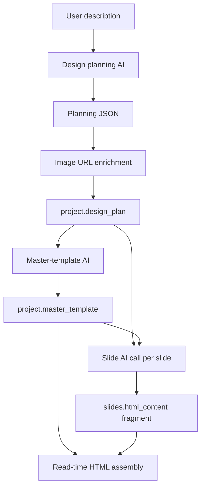

# Slide Generation AI Context and Output Contracts

This document describes the **current implementation** of AI context construction for master-template and slide generation. It also identifies contract problems that can cause malformed HTML or poor layouts and proposes a stricter contract for approval.

No runtime behavior described under **Proposed contract** is implemented yet.

## Generation pipeline overview



The pipeline makes several independent OpenRouter calls:

1. One design-plan call.
2. One master-template call using the saved design plan.
3. One slide-generation call per slide.

OpenRouter does not retain conversation history between these calls. Every call contains only the system and user messages explicitly constructed in the current request.

---

# 1. Source design plan

The design-planning job creates JSON matching `server/src/schemas/planning.schema.js`. It enriches each planned image with a Pexels `src` field and stores the complete result as serialized JSON in `project.design_plan`.

Conceptually, the persisted design plan has this shape:

```json
{
  "project": {
    "title": "string",
    "topic": "string",
    "purpose": "string",
    "audience": "string",
    "language": "string",
    "slideCount": 2
  },
  "globalDesign": {
    "theme": "string",
    "primary_color": "#000000",
    "secondary_color": "#000000",
    "accent_color": "#000000",
    "background_color": "#000000",
    "text_color": "#000000",
    "heading_font": "Arial",
    "subHeading_font": "Arial",
    "body_font": "Arial",
    "designConcepts": "string",
    "overallGuidelines": "string"
  },
  "masterTemplate": {
    "backgroundType": "string",
    "backgroundDescription": "string",
    "persistentElements": [
      {
        "type": "string",
        "position": "string"
      }
    ]
  },
  "slides": [
    {
      "number": 1,
      "title": "string",
      "objective": "string",
      "content": "presentation-ready Markdown",
      "layout": "string",
      "background": "string",
      "elementPlacement": "string",
      "visualHierarchy": "string",
      "stylingNotes": "string",
      "images": [
        {
          "purpose": "string",
          "keyword": "string",
          "orientation": "landscape",
          "src": "https://resolved-image-url"
        }
      ]
    }
  ]
}
```

`src` is not part of the original response schema. It is added by `design.job.js` after the planning model responds and before the plan is stored.

---

# 2. Master-template generation

## 2.1 Context from prompt

The system message is the full contents of:

- `server/src/prompts/slides.master-template.md`

It tells the model to act as a presentation template architect and generate shared deck scaffolding rather than slide-specific content.

The principal instructions are:

- Generate shared CSS and a `.slide` wrapper.
- Use dimensions `1280px × 720px`.
- Define design tokens as CSS custom properties on `.slide`.
- Implement the planned master background.
- Add persistent elements.
- Provide reusable classes such as `.title`, `.subtitle`, `.card`, and `.kicker`.
- Use web-safe fonts.
- Avoid IDs, external assets, global selectors, prose, and Markdown fences.

## 2.2 Context from previous generations

The master-template call receives one previous AI generation:

- The complete design plan previously generated by the design-planning model and enriched with image URLs.

It does **not** receive:

- Previously generated master templates.
- Previously generated slide HTML.
- Existing rows from the `slides` table.
- A conversation history.
- User corrections made after the design plan unless those corrections were persisted into `project.design_plan`.

The job reads `project.design_plan` from SQLite immediately before calling OpenRouter. The database is treated as the source of truth.

## 2.3 Context from design-plan JSON

The current code sends the **entire design plan** as the user message:

```js
userPrompt: JSON.stringify(designPlan)
```

Therefore, the master model receives:

- `project`: all project metadata.
- `globalDesign`: all colors, fonts, theme, concepts, and overall guidelines.
- `masterTemplate`: background and persistent-element specifications.
- `slides`: every slide's content and layout plan.
- Resolved `images[].src` values added by the design job.

Although the master should need only project/global/master information plus a compact deck overview, it currently receives every slide in full. This increases prompt size and may encourage the model to leak slide-specific decisions into the master.

## 2.4 Exact OpenRouter message structure

The request is equivalent to:

```json
{
  "model": "<main model from settings or job data>",
  "messages": [
    {
      "role": "system",
      "content": "<entire slides.master-template.md file>"
    },
    {
      "role": "user",
      "content": "<JSON.stringify of the complete persisted design plan>"
    }
  ]
}
```

Current request options:

- Timeout: `180000 ms`.
- Streaming: disabled.
- SDK retries: disabled by `openrouter.js`.
- Structured output/JSON schema: not used.
- HTML MIME/grammar enforcement: not used.

## 2.5 Output structure currently requested

The prompt requests raw HTML only, specifically:

```html
<style>
  .slide { /* master styles and tokens */ }
  /* persistent and shared utility classes */
</style>
<div class="slide">{{CONTENT}}</div>
```

Rules currently requested:

- Exactly one `<style>` block.
- No `<!doctype html>`.
- No `<html>`, `<head>`, or `<body>`.
- No Markdown fences.
- No prose.
- A literal `{{CONTENT}}` placeholder.
- A root `<div class="slide">`.

No machine-enforced response format is configured. Compliance is prompt-based only.

## 2.6 Current post-processing

After OpenRouter responds, the job:

1. Reads `response.choices[0].message.content`.
2. Rejects an empty response.
3. Calls `stripCodeFences()`:
   - Removes a surrounding Markdown fence such as ` ```html ... ``` `.
   - Attempts to remove an unclosed leading fence.
4. Rejects content shorter than 20 characters.
5. Stores the remaining string directly in `project.master_template`.

The current post-processing does **not** verify:

- That there is exactly one `<style>` block.
- That `.slide` is defined.
- That there is exactly one `.slide` root.
- That `{{CONTENT}}` exists exactly once.
- That forbidden document tags are absent.
- That CSS dimensions are `1280px × 720px`.
- That persistent elements are present.
- That scripts, external resources, or unsafe markup are absent.

## 2.7 Current master-contract defect

The prompt requires persistent elements to “appear as absolutely-positioned elements inside `.slide`,” but the required root is exactly:

```html
<div class="slide">{{CONTENT}}</div>
```

There is no explicit place for persistent element markup unless the model changes the required root to something like:

```html
<div class="slide">
  <div class="persistent logo"></div>
  <div class="persistent slide-number"></div>
  {{CONTENT}}
</div>
```

The example saved in `plan.md` defines persistent-element CSS but contains no persistent-element HTML. This is a direct consequence of the ambiguous contract.

---

# 3. Per-slide generation

A separate OpenRouter request is made for every entry in `designPlan.slides`. Calls are currently sequential.

## 3.1 Context from prompt

The system message is the full contents of:

- `server/src/prompts/slides.html.md`

It tells the model to generate only the markup inserted at `{{CONTENT}}` inside the master `.slide` wrapper.

The principal instructions are:

- Return one inner HTML fragment.
- Do not repeat the master or `.slide` wrapper.
- Convert the planned Markdown content into semantic HTML.
- Reuse master classes and CSS custom properties.
- Honor `layout`, `elementPlacement`, `visualHierarchy`, and `stylingNotes`.
- Use resolved image URLs only.
- Use explicit placement for major elements.
- Avoid overlaps and preserve whitespace.
- Return no prose or Markdown fences.

## 3.2 Context from previous generations

Each slide call receives:

- The master template generated immediately before the slide loop.
- The design plan generated during the earlier design job, but only selected portions of it.

Each slide call does **not** receive:

- HTML generated for prior slides.
- HTML stored in existing slide rows.
- The plan for other individual slides.
- A screenshot or rendered preview of the master.
- Browser layout measurements.
- Feedback about overflow or overlap from previously rendered slides.
- A conversation history.

This means slide 2 cannot see slide 1's concrete implementation. Visual consistency relies only on the master, `globalDesign`, the prompt, and the current slide plan.

## 3.3 Context from design-plan JSON

For each `slidePlan`, the current job constructs:

```js
{
  masterTemplate,
  slide: slidePlan,
  globalDesign: designPlan.globalDesign,
  project: designPlan.project
}
```

It sends that object as `JSON.stringify(...)` in the user message.

The model receives these design-plan sections:

### `project`

All project fields:

- `title`
- `topic`
- `purpose`
- `audience`
- `language`
- `slideCount`

### `globalDesign`

All global design fields:

- `theme`
- five color values
- three font values
- `designConcepts`
- `overallGuidelines`

### `slide`

Only the current slide's full plan:

- `number`
- `title`
- `objective`
- `content`
- `layout`
- `background`
- `elementPlacement`
- `visualHierarchy`
- `stylingNotes`
- `images`, including enriched `src` values where available

The model does not receive `designPlan.masterTemplate` directly in this call. It sees the **generated master HTML** instead, plus `globalDesign` and the current slide.

The model also does not receive the complete `designPlan.slides` array, despite the slide prompt saying it receives “the full design plan.” This is a mismatch between prompt wording and actual payload.

## 3.4 Exact OpenRouter message structure

Each slide request is equivalent to:

```json
{
  "model": "<main model from settings or job data>",
  "messages": [
    {
      "role": "system",
      "content": "<entire slides.html.md file>"
    },
    {
      "role": "user",
      "content": "{\"masterTemplate\":\"<generated master HTML>\",\"slide\":{...},\"globalDesign\":{...},\"project\":{...}}"
    }
  ]
}
```

Current request options:

- Timeout: `180000 ms` per slide.
- Streaming: disabled.
- SDK retries: disabled.
- Structured output/JSON schema: not used.
- HTML MIME/grammar enforcement: not used.

## 3.5 Output structure currently requested

The intended output is a raw inner fragment such as:

```html
<div class="content s2-content">
  <h1 class="title">Slide title</h1>
  <div class="s2-body">
    <!-- slide-specific content -->
  </div>
</div>
```

It should not contain:

- `<!doctype html>`
- `<html>`
- `<head>`
- `<body>`
- `<div class="slide">`
- a repeated master template
- Markdown fences
- commentary

The prompt currently has a contradiction:

- Hard constraints say the model must not output `<style>`.
- The content section later says a missing class may be defined through a small inline `<style>`.

That contradiction makes slide-specific styling unpredictable. It likely contributed to slide 1 returning a `<style>` block while slide 2 used inline styles.

## 3.6 Current post-processing

For each response, the job:

1. Reads `response.choices[0].message.content`.
2. Rejects an empty response.
3. Calls `stripCodeFences()`.
4. Calls `normalizeSlideFragment()`:
   - Removes `<!doctype ...>`.
   - Removes opening and closing `html`, `head`, and `body` tags.
   - If the entire response is one top-level `<div class="slide">...</div>`, removes that wrapper.
5. Rejects content shorter than five characters.
6. Updates an existing row for the sequence number, or inserts a new row.
7. Stores the normalized value in `slides.html_content`.

The current post-processing does **not** detect or remove:

- A repeated master `<style>` block.
- A repeated master template containing `{{CONTENT}}`.
- Multiple `.slide` wrappers.
- A `.slide` wrapper with additional classes or unusual attribute ordering.
- Scripts or event-handler attributes.
- CSS that overrides the master globally.
- External stylesheets or fonts.
- Missing content from the slide plan.
- Layout overflow, clipping, overlap, or unreadably small text.

The slide 1 output in `plan.md` is a repeated master template. It passed because it was longer than five characters and did not match the narrow outer-wrapper regular expression: the leading `<style>` prevented the whole response from beginning with `<div class="slide">`.

---

# 4. Why layouts can be mishandled

## 4.1 Layout instructions are unstructured prose

The important placement fields are plain strings:

- `layout`
- `elementPlacement`
- `visualHierarchy`
- `stylingNotes`

They express intent but do not provide machine-checkable geometry. For example, “text occupies the left 40%” is useful, but the model still decides exact coordinates, padding, and height.

## 4.2 The master uses padding while slides use absolute coordinates

The generated master in `plan.md` applies:

```css
.slide {
  padding: 60px;
}
```

The slide model then uses absolute positions such as `top: 40px; left: 60px`. Absolutely positioned children use the `.slide` padding box as their containing block in ways that can be unintuitive. The title can enter the intended master margin/persistent-element area.

A clearer contract should define a dedicated content canvas, for example:

```css
.slide-content {
  position: absolute;
  inset: 60px;
}
```

Then slide fragments place elements relative to a known `1160px × 600px` content area rather than the entire slide.

## 4.3 No concrete layout budget is supplied

The slide prompt asks for visual hierarchy but does not define:

- safe-area boundaries,
- reserved regions for logo/footer/slide number,
- maximum text height,
- maximum list-item count,
- image crop rules per layout,
- title/body regions,
- z-index layers,
- fallback behavior when content does not fit.

## 4.4 No render-and-correct loop exists

After HTML generation, the server does not render the slide and check:

- overflow,
- overlapping bounding boxes,
- elements outside the slide,
- image load failures,
- text clipping,
- contrast.

Prompt instructions alone cannot guarantee layout correctness.

## 4.5 No strict output enforcement exists

Unlike the planning call, HTML calls use no response schema. OpenRouter receives ordinary text-generation requests. “HTML only” is requested in the prompt, but code fences and invalid structures remain possible.

## 4.6 No previous slide HTML is provided

This avoids copying mistakes but also means concrete layout conventions developed in earlier slides are unavailable. The shared master supplies colors and utility classes, but not a structured layout system for timeline, comparison, grid, hero, and other slide types.

---

# 5. Proposed stricter HTML-only contract

The following is recommended for implementation after approval.

## 5.1 Master input payload

Instead of sending the entire design plan, send a named, explicit object:

```json
{
  "outputContract": {
    "format": "html-fragment",
    "requiredPlaceholder": "{{CONTENT}}",
    "slideWidth": 1280,
    "slideHeight": 720
  },
  "project": {
    "title": "...",
    "topic": "...",
    "audience": "...",
    "purpose": "..."
  },
  "globalDesign": {
    "theme": "...",
    "colors": {
      "primary": "...",
      "secondary": "...",
      "accent": "...",
      "background": "...",
      "text": "..."
    },
    "fonts": {
      "heading": "...",
      "subheading": "...",
      "body": "..."
    },
    "designConcepts": "...",
    "overallGuidelines": "..."
  },
  "masterTemplatePlan": {
    "backgroundType": "...",
    "backgroundDescription": "...",
    "persistentElements": []
  },
  "deckLayoutNeeds": [
    "Hero Layout",
    "Timeline",
    "Comparison"
  ]
}
```

`deckLayoutNeeds` can be derived from distinct `slides[].layout` values without sending all slide content.

## 5.2 Master output

Use one unambiguous fragment shape:

```html
<style>
  .slide { position: relative; width: 1280px; height: 720px; overflow: hidden; }
  .slide-content { position: absolute; inset: 60px; }
  /* master tokens, persistent elements, and reusable layout classes */
</style>
<div class="slide">
  <div class="persistent-layer">
    <!-- actual persistent element markup -->
  </div>
  <main class="slide-content">{{CONTENT}}</main>
</div>
```

Required validation before storage:

- Exactly one `<style>` block.
- Exactly one `.slide` root.
- Exactly one `.slide-content` element.
- Exactly one literal `{{CONTENT}}`.
- No document tags, scripts, external stylesheets, or event-handler attributes.
- Width and height are present.

## 5.3 Slide input payload

Send an explicit geometry and output contract alongside the current slide:

```json
{
  "outputContract": {
    "format": "html-fragment",
    "forbiddenTags": ["html", "head", "body", "style", "script"],
    "forbiddenRootClass": "slide",
    "singleRootClass": "slide-layout",
    "coordinateSystem": {
      "width": 1160,
      "height": 600,
      "origin": "top-left of .slide-content"
    }
  },
  "masterTemplate": "<validated master fragment>",
  "project": {},
  "globalDesign": {},
  "slide": {
    "number": 1,
    "title": "...",
    "objective": "...",
    "content": "...",
    "layout": "...",
    "background": "...",
    "elementPlacement": "...",
    "visualHierarchy": "...",
    "stylingNotes": "...",
    "images": []
  }
}
```

## 5.4 Slide output

Require one root element and no `<style>`:

```html
<section class="slide-layout slide-layout--comparison" data-slide-number="2">
  <!-- semantic slide content -->
</section>
```

Styling options, in preference order:

1. Reuse layout and utility classes supplied by the master.
2. Use CSS custom properties from the master.
3. Use tightly scoped inline `style` values only for slide-specific dimensions/placement.

This removes the current `<style>` contradiction and makes normalization deterministic.

## 5.5 Programmatic post-processing

Recommended processing order:

1. Strip Markdown code fences.
2. Reject empty output.
3. Parse as an HTML fragment rather than relying only on regular expressions.
4. Reject or remove document tags, scripts, external resources, event attributes, and a repeated master.
5. Require exactly one `.slide-layout` root.
6. Reject any `.slide` root or `{{CONTENT}}` placeholder in slide output.
7. Store only the validated fragment.
8. At read time, replace the master's one `{{CONTENT}}` placeholder with the fragment.
9. Set the slide number on the assembled `.slide` or number element.
10. Wrap the result in independent boilerplate:

```html
<!doctype html>
<html lang="en">
<head>
  <meta charset="UTF-8">
  <meta name="viewport" content="width=1280, initial-scale=1.0">
  <title>Slide 2</title>
</head>
<body>
  <!-- assembled validated master + fragment -->
</body>
</html>
```

## 5.6 Layout validation recommendation

HTML-only output can be strongly encouraged and structurally validated, but correct layout requires rendering. A later validation step should use the existing Playwright dependency to render each assembled slide at `1280 × 720` and inspect:

- horizontal/vertical overflow,
- elements outside the slide bounds,
- text clipping,
- obvious overlaps,
- image loading failures.

A failed layout can either:

- mark the slide failed with diagnostics, or
- make one correction call containing only the current HTML and measured layout errors.

This render/correction loop is separate from the initial status and assembly fix and should be implemented only if approved.

---

# 6. Current versus proposed summary

| Area | Current | Proposed |
|---|---|---|
| Master design-plan context | Entire persisted plan, including every slide | Project/global/master plan plus distinct deck layout needs |
| Master previous output context | None | None |
| Master output enforcement | Prompt only | Prompt plus structural HTML validation |
| Persistent elements | Ambiguous; CSS may exist without markup | Explicit markup inside a persistent layer |
| Slide design-plan context | Project, global design, current slide | Same, plus explicit output/geometry contract |
| Slide previous output context | Master only; no prior slides | Master only by default |
| Slide output | Unstructured inner fragment | One `.slide-layout` root, no `<style>` |
| Slide styling | Master classes, inline styles, contradictory optional `<style>` | Master classes/tokens plus scoped inline positioning only |
| Post-processing | Code-fence stripping and narrow regex cleanup | HTML parsing and contract validation |
| Layout verification | None | Optional Playwright render validation/correction |
| Final API HTML | Currently raw stored fragment | Master + fragment + complete document boilerplate |

---

# 7. Approval points before implementation

1. Approve the proposed master shape with `.persistent-layer` and `.slide-content`.
2. Approve excluding complete slide content from the master call and sending only distinct `deckLayoutNeeds`.
3. Approve a single `.slide-layout` root and a strict ban on slide-level `<style>` blocks.
4. Choose whether Playwright layout validation is part of the current implementation or a later phase.
5. Choose layout failure behavior if validation is enabled:
   - fail and expose diagnostics, or
   - make one AI correction request and fail only if correction remains invalid.
